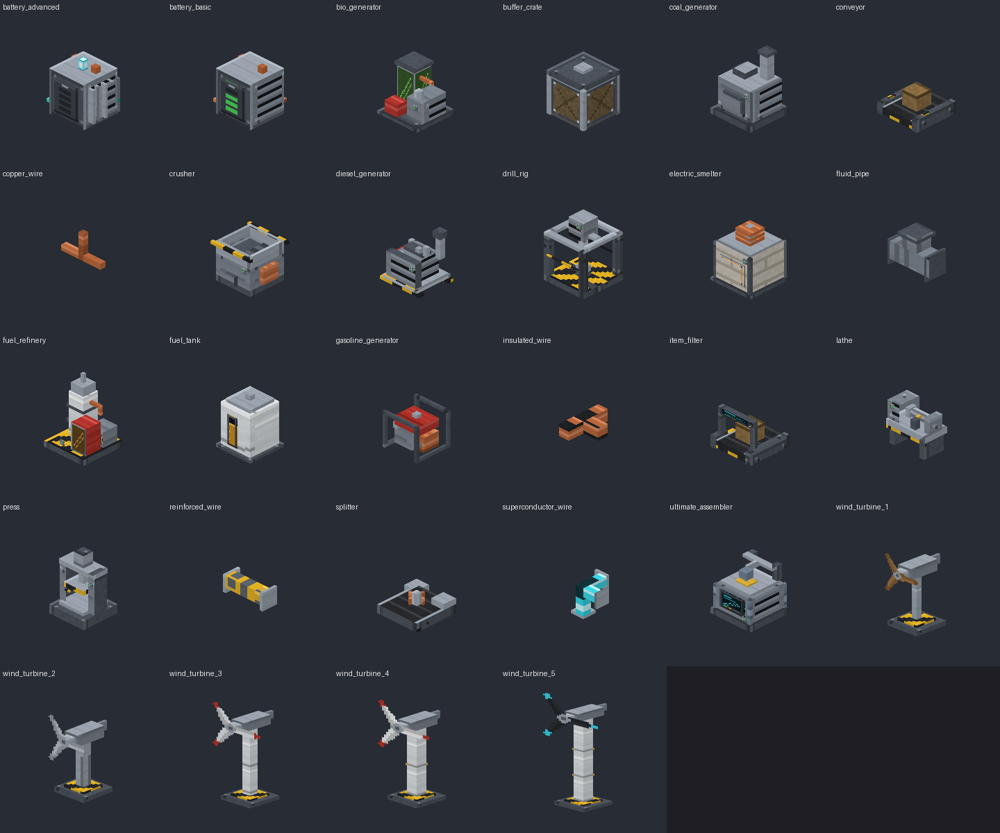

# TechCore — технологический аддон для Minecraft Bedrock 1.26.52

Промышленные машины, производственные цепочки, энергосети с потерями и приоритетами, ветровые и топливные
генераторы, аккумуляторы, конвейеры, трубы, жидкое топливо и **Ультимативный сборщик** с уровнями Ур-0…Ур-5
(сетки 4×4, 5×4, 5×6, 7×7, 8×7, 9×9). Плюс **инженерные очки**: надеваются в отдельный слот шлема (или во вторую
руку) и при взгляде на блок показывают его эффективность и потребление/выработку энергии.

- Behavior Pack + Resource Pack, скрипты на **стабильном** Script API (`@minecraft/server` 2.10.0,
  `@minecraft/server-ui` 2.2.0), без экспериментов.
- 28 блоков с собственными 3D-моделями, 50 предметов, 76 процедурных текстур (включая flipbook-анимации),
  PBR-наборы для Vibrant Visuals.
- Готовые архивы: [`dist/TechCore.mcaddon`](dist/TechCore.mcaddon), `dist/TechCore_BP.mcpack`, `dist/TechCore_RP.mcpack`.

> **Честно о проверке.** Аддон собран и проверен автоматически (проверка типов против официального API,
> 53 теста логики и сценариев на имитации API, структурная валидация пакетов, рендер моделей для визуального
> контроля), но **не запускался в самом Minecraft** — клиента игры в среде разработки нет. Перед использованием
> пройдите чек-лист [docs/TESTING.md](docs/TESTING.md) и пришлите журнал контента, если что-то не так.



## Документация

| Документ | Содержание |
|---|---|
| [docs/INSTALLATION.md](docs/INSTALLATION.md) | установка, первые шаги, сборка из исходников |
| [docs/RECIPES.md](docs/RECIPES.md) | все рецепты (генерируется из игровых данных) |
| [docs/BALANCE.md](docs/BALANCE.md) | мощности, топливо, ветер, нагрев, провода, прогрессия |
| [docs/TECHNICAL_LIMITATIONS.md](docs/TECHNICAL_LIMITATIONS.md) | ограничения Bedrock и принятые решения |
| [docs/TESTING.md](docs/TESTING.md) | что проверено автоматически и чек-лист проверки в игре |

## Как устроена сетка сборщика

Bedrock не позволяет создать скриптом произвольную сетку слотов (верстак — только 3×3, формы `server-ui`
не содержат слотов, инвентарь блока — экспериментальный и максимум 54 слота). Поэтому сборщик — машина с
внутренним хранилищем: ингредиенты загружаются кнопкой «Загрузить ингредиенты на ×N» (берётся ровно недостающее)
или конвейерами, а сетка рецепта задаёт его форму, размер и стоимость. Уровень ограничивает размер рецепта,
меньшие рецепты доступны и на старших уровнях. Подробно — в [TECHNICAL_LIMITATIONS.md](docs/TECHNICAL_LIMITATIONS.md).

## Что входит

| Группа | Содержимое |
|---|---|
| Сборщик | Ультимативный сборщик Ур-0…Ур-5: рецепты, очередь ×1/×4/×16, авто-режим, хранилище, модернизация с энергией, смена модели по уровню, упакованные сборщики при разборке |
| Генераторы | ветрогенераторы I–V (мультиблоки 2–4 блока, вращение ротора с 3 скоростями), угольный, дизельный, бензиновый, биотопливный; состояния: работа, ожидание, нет топлива/ветра, перегрев |
| Энергия | медный, изолированный, усиленный, сверхпроводящий провода (пропускная способность и потери), аккумулятор и улучшенный аккумулятор, приоритеты, обзор сети |
| Производство | буровая установка, дробитель, электроплавильня, пресс, токарный станок, переработчик топлива |
| Транспорт | конвейер, фильтр предметов, разветвитель, буферный контейнер; работа с сундуками, бочками, воронками, шалкерами |
| Жидкости | топливные трубы, топливный резервуар, канистры |
| Инструменты | инженерные очки (HUD), гаечный ключ (поворот лент, обзор и настройки) |

## Структура

```
TechCore/
  behavior_pack/
    manifest.json, pack_icon.png, texts/
    blocks/ items/ recipes/            ← генерируются tools/build_assets.mjs
    scripts/
      main.js                          ← точка входа
      data/      config, items, machines, recipes, assembler_recipes, generators, wires, progression, drill
      logic/     чистая логика без API Minecraft: slots, crafting, energy, wind, heat, fluids (покрыта тестами)
      core/      позиции, блоки, инвентарь, тексты, журнал
      systems/   Registry, PersistenceSystem, MachineSystem, EnergySystem, GeneratorSystem, FuelSystem,
                 CraftingSystem, UpgradeSystem, TransportSystem, AnimationSystem, ConnectionSystem,
                 GogglesSystem, SettingsSystem, BlockEvents, kinds
      ui/        common, MachineUI, AssemblerUI, NetworkUI
  resource_pack/
    manifest.json (capability pbr), models/blocks/*.geo.json, attachables/, texts/,
    textures/ (terrain_texture, item_texture, flipbook_textures, techcore/*: PNG + texture_set)
  tools/
    build_assets.mjs  генератор ресурсов (текстуры, модели, JSON, языки, рецепты, манифесты, RECIPES.md)
    assets/           PNG-кодер, процедурная графика, модели, конфигурация блоков, иконки
    validate.mjs      структурная проверка пакетов
    package.py        упаковка .mcpack/.mcaddon
    preview.py        изометрический предпросмотр моделей (Pillow) → docs/preview.png
    tests/            юнит-тесты, проверки данных, интеграционные сценарии на имитации API
  docs/
  dist/
```

Единый источник данных — `behavior_pack/scripts/data/*.js`: их используют и игра, и генератор, поэтому рецепты,
названия, JSON блоков и документация не расходятся. Модели, текстуры и иконки — исходники в `tools/assets`;
их можно открыть и доработать в Blockbench (форматы стандартные).

## Состояние этапов ТЗ

| Этап | Статус |
|---|---|
| 1. Технический прототип: пакеты, сборщик Ур-0, шестерня, точный рецепт, модель, интерфейс, производство, проверка ресурсов, сохранение, безопасная выдача | реализовано |
| 2. Первая энергетика: ветрогенератор, угольный генератор, провода, аккумулятор, сеть, визуальные состояния | реализовано |
| 3. Машины: дробитель, электроплавильня, пресс, токарный станок, цепочки | реализовано |
| 4. Транспорт и топливо: конвейеры, фильтры, разветвители, трубы, резервуары, переработчик, дизельный/бензиновый/биотопливный генераторы | реализовано (насос — функцию выполняет трубная сеть) |
| 5. Полная прогрессия: 5 ветрогенераторов, Ур-1…Ур-5, поздние материалы, баланс, документация | реализовано; баланс — стартовый, требует игровой обкатки |

## Известные риски, требующие проверки в игре

- Направление конвейера при установке задаётся чертой `minecraft:placement_direction`; если лента окажется
  направлена «к игроку», а не «от игрока», её можно повернуть ключом, а смещение исправляется одной строкой в
  `tools/assets/blocks.mjs` (`y_rotation_offset`).
- Отображение плоскости ротора с `alpha_test` и flipbook-текстурой 32×32 в атласе блоков.
- Звуковые события ванильного пакета: при отсутствии события в версии звук просто не играет.
