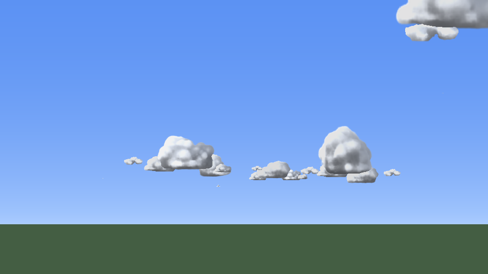
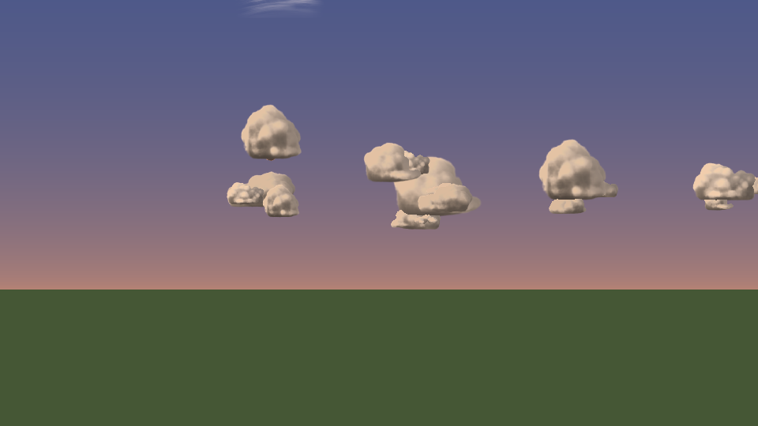
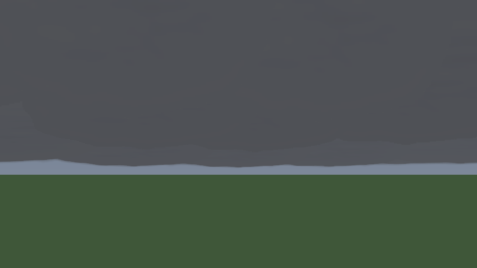
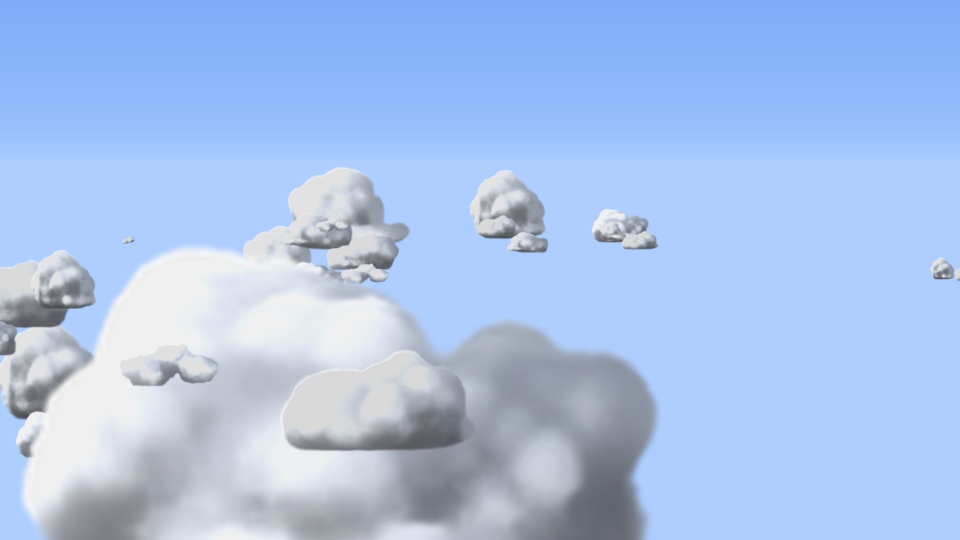
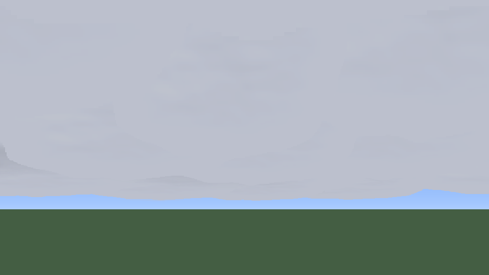

# Ultra Clouds — M1X fast Clouds Ultimate

Система облаков для **Minecraft Bedrock Edition 1.26.52** (проверено против данных и API версии 1.26.50/1.26.52):
полностью заменяет стандартные «кубические» облака небом из объёмных облаков-импостеров —
кучевые, слоисто-кучевые, высококучевые, перистые и грозовые облака, которые плывут по ветру,
рождаются и тают, меняют цвет на рассвете и закате, темнеют перед грозой и правильно
выглядят как с земли, так и с вершины горы над облаками. Все настройки — в игровом меню
и применяются мгновенно.

> **Честно о статусе.** Пакет собран и проверен **офлайн**: JSON и Molang разобраны и
> сверены с официальными метаданными 1.26.50, скрипты прошли проверку типов против
> официальных `@minecraft/server 2.10.0` / `@minecraft/server-ui 2.2.0`, а кадр
> симулирован исполнением настоящего Molang пакета (см. «Тестирование»).
> **Запуск в самой игре в среде разработки был невозможен** — в разделе «Не проверено»
> перечислено, что нужно проверить вручную и какие места архитектуры зависят от
> поведения движка.



| | |
|---|---|
|  |  |
|  |  |

*Превью построены офлайн-симулятором (`tools/simulate.py`). Он исполняет Molang пакета и
повторяет работу видеокарты: 16-битный буфер глубины, как на телефонах, альфа-тест,
смешивание и формулы ванильного шейдера сущностей. Небо, земля и туман на превью —
упрощённые заглушки, в игре их рисует сама игра.*

## Что нового в 1.1

* **Исправлены «обрезанные» облака и странные просветы между ними.** В 1.0 у каждого
  спрайта был свой «слот» глубины, и все слоты укладывались в несколько блоков. На
  телефонах буфер глубины грубый, поэтому соседние слоты сливались. Прозрачная часть
  прямоугольного спрайта тоже записывает глубину и вырезала куски облаков за собой.
  Теперь каждое облако рисуется в два прохода:
  1. плотная середина — альфа-тестом (прозрачные пиксели не пишут глубину вообще);
  2. мягкий край — отдельным проходом поверх, от дальних облаков к ближним.

  Глубина берётся из настоящего расстояния до облака, поэтому ближние облака закрывают
  дальние сами, при любой точности буфера и в любом порядке отрисовки (подробнее —
  «Порядок прорисовки» ниже).
* **Облака больше не серые.** Ванильный шейдер сущностей затеняет грани по нормали. В 1.0
  это компенсировалось цветом материала, но шейдер обрезает цвет до 1, и на «Красивой»
  графике облака темнели на 10–30 %. Теперь компенсация и всё, что ярче 1, идут через
  `light_color_multiplier` рендер-контроллера (тот же механизм, что у ванильного брииза
  со значением 1,8). Затемнение ночью и в грозу осталось в цвете материала.
* **Нет тонких полос у горизонта.** Слоистые пласты у горизонта больше не сплющиваются в
  линию: они плавно исчезают ниже ~5–8° над горизонтом.
* **Сплошная облачность действительно сплошная.** Её «потолок» перестроен:
  * отдельная текстура плотного пласта;
  * три кольца и пласт в зените, рассчитанные на перекрытие;
  * исправлено ограничение «не ниже горизонта»: оно не учитывало наклон камеры и при
    взгляде вверх зря укорачивало пласты.

  В симуляторе при любом направлении взгляда открытого неба выше 4° остаётся не больше
  0,4 %. Швов между пластами нет.
* **Перистые облака** стали крупнее и реже (15 образований вместо 30) и больше не режут
  друг друга.
* **Основание кучевого облака** теперь лежит позади тела облака и выглядывает снизу
  тёмной подошвой, а не висит поверх тела отдельным тёмным облаком.
* **Новое меню «Количество облаков по слоям»:** общее количество облаков и отдельно
  кучевые, слоистые, высококучевые и перистые (0–200 %).
* **Текстуры:**
  * слоистые и высококучевые облака получили плотную середину и мягкий край;
  * у оснований кучевых больше нет плоско обрезанных боков;
  * края текстур больше не светлее середины (это давало светлые швы).
* **Тесты:** симулятор теперь проверяет порядок по глубине, эмулирует 16- и 24-битный
  буфер глубины и сравнивает кадр с идеальной сортировкой (см. «Тестирование»).

Пакеты 1.1 имеют те же UUID и более высокую версию, поэтому импорт поверх 1.0
обновляет их. Настройки игроков сохраняются, новые параметры получают значения
по умолчанию.

---

## Содержание

1. [Установка](#установка)
2. [Стандартные облака: как выключить и включить](#стандартные-облака-как-выключить-и-включить)
3. [Меню и команды](#меню-и-команды)
4. [Настройки](#настройки)
5. [Профили и типы облаков](#профили-и-типы-облаков)
6. [Как это устроено](#как-это-устроено)
7. [Производительность](#производительность)
8. [Известные ограничения](#известные-ограничения)
9. [Тестирование](#тестирование)
10. [Структура проекта и сборка](#структура-проекта-и-сборка)

---

## Установка

Готовые файлы лежат в `dist/`:

| Файл | Что это |
|---|---|
| `dist/UltraClouds.mcaddon` | оба пакета сразу (рекомендуется) |
| `dist/UltraClouds_RP.mcpack` | только ресурс-пак (облака, текстуры, тексты) |
| `dist/UltraClouds_BP.mcpack` | только пакет поведения (скрипт, меню, сущность) |

1. **Импорт.** Откройте `UltraClouds.mcaddon` через Minecraft:
   * Android — нажмите на файл и выберите «Открыть с помощью Minecraft»;
   * iOS/iPadOS — «Файлы» → файл → «Поделиться» → Minecraft;
   * Windows — двойной щелчок.
   Игра покажет «Import started… Successfully imported» для обоих пакетов.
2. **Мир.** Создать мир (или «Изменить» существующий) → **Наборы параметров поведения** →
   активировать **Ultra Clouds (Behavior)**. Ресурс-пак **Ultra Clouds (Resources)** подключится
   автоматически (пакеты зависят друг от друга); проверьте, что он стоит в **Наборах ресурсов**.
3. **Сабпак** (шестерёнка у ресурс-пака):
   * **Standard** — текстуры 1024 px, стандартные облака скрыты (по умолчанию на большинстве устройств);
   * **Lite** — текстуры 512 px (в 4 раза меньше видеопамяти), стандартные облака скрыты;
   * **Keep vanilla clouds** — ничего не скрывает (см. следующий раздел).
4. **Экспериментальные функции не нужны.** Используются только стабильные API:
   Script API `@minecraft/server 2.10.0`, `@minecraft/server-ui 2.2.0`, свойства сущностей,
   пользовательские команды, Molang клиентских сущностей.
5. Зайдите в мир: появится сообщение. Предмета в инвентаре нет. Если у вас остался предмет
   «Настройки облаков» из версий 1.0/1.1, он исчезнет из инвентаря при входе.

Работает в одиночной игре, на LAN, на Realms и серверах с включёнными аддонами. Каждый игрок
видит **своё** небо.

## Настройки пакета (без предмета)

Главные настройки находятся в настройках самого пакета:
* **перед входом в мир:** «Изменить» мир → «Наборы параметров поведения» → Ultra Clouds →
  шестерёнка;
* **прямо в игре:** «Настройки» → «Наборы параметров поведения» → Ultra Clouds → шестерёнка.

Там есть:
* включение облаков, профиль («Авто» подбирает его по устройству) и тип облаков;
* количество облаков: общее и отдельно кучевые, слоистые, высококучевые и перистые;
* размер, высота, скорость и направление ветра, мягкость краёв, яркость, тёплые закаты;
* глубина неба (0 = автоматически), режим оптимизации и автоматический выбор качества.

Изменения появляются на небе примерно через секунду, перезаходить в мир не нужно. Это
настройки мира: их меняет владелец, и они действуют для всех игроков. Технически это
`settings` в манифесте пакета поведения (формат 3), скрипт читает их через
`world.getPackSettings()`.

Личное меню `/clouds` по-прежнему работает: каждый игрок может подстроить своё небо. Личное
изменение держится, пока владелец не поменяет этот же пункт в настройках пакета.

## Стандартные облака: как выключить и включить

Официального API, позволяющего аддону выключать облака «на лету», в Bedrock нет. Есть два
надёжных и официально поддерживаемых способа:

1. **Сабпак ресурс-пака** (Standard / Lite). Он подменяет `textures/environment/clouds.png`
   полностью прозрачной картой: игра строит облака по этой карте, поэтому ни одного
   стандартного облака не остаётся. Это работает независимо от настроек игрока.
2. **Настройки → Видео → «Отображать облака» (Render Clouds) = выкл.** Этот переключатель
   выключает только стандартный облачный слой; облака Ultra Clouds — это отдельная
   сущность, на неё он не влияет. Используйте вместе с сабпаком **Keep vanilla clouds**,
   если хотите переключать стандартные облака без перезагрузки пакетов.

**Вернуть стандартные облака:** выберите сабпак **Keep vanilla clouds** и включите
«Отображать облака» (или просто отключите ресурс-пак Ultra Clouds).
Переключатель «Включить Ultra Clouds» в меню скрывает только облака Ultra Clouds —
стандартные облака он не возвращает (это ограничение Bedrock: скрипт не может менять
ресурс-пак).

## Меню и команды

* **`/clouds`** — открыть меню (полное имя: `/ultra_clouds:clouds`).
* `/clouds on` · `off` · `toggle` — включить/выключить облака для себя.
* `/clouds reset` — сбросить настройки к значениям по умолчанию для вашего устройства.
* `/clouds status` — состояние, профиль и качество в чате.
* `/clouds debug` — подробная диагностика в чат: устройство, все настройки, погода, состояние
  «небесной установки» и значения, переданные облакам. Пришлите этот текст вместе со
  скриншотом, если облака выглядят неправильно.
* `/clouds classic` — открыть классическое меню (если живое меню не отображается).

Команды не требуют читов и доступны любому игроку (каждый меняет только своё небо).

**Живое меню.** На 1.26.50+ используется новый data-driven интерфейс (`CustomForm`):
ползунки и переключатели применяются **сразу, пока меню открыто** — облака плавно
перестраиваются у вас на глазах (все параметры сглажены по времени, без рывков). Если клиент
не умеет показывать такие формы, меню автоматически переключается на классические формы,
где изменения применяются кнопкой «Применить». Перезапуск мира не нужен никогда.

Главная страница: включение, профиль, тип облаков, количество облаков и кнопки разделов
«Количество облаков по слоям», «Качество и производительность», «Форма и движение»,
«Освещение и атмосфера», «Сбросить настройки». У каждого параметра есть описание
(RU/EN по языку игры).

## Настройки

Все параметры реально меняют картинку или нагрузку; ниже — что именно делает каждый.

### Основные

| Параметр | Диапазон | Что делает |
|---|---|---|
| Включить Ultra Clouds | вкл/выкл | показывает/убирает небо (сущность удаляется, нагрузка = 0) |
| Профиль | 6 вариантов | готовые наборы качества (см. ниже); ручное изменение → «Пользовательский» |
| Тип облаков | 8 вариантов | какие слои формируются (кучевые, слоистые, высококучевые, перистые) |
| Количество облаков | 0–100 % | доля неба под облаками; 50 % — естественно для типа |

### Количество облаков по слоям

| Параметр | Диапазон | Что делает |
|---|---|---|
| Количество облаков | 0–100 % | то же, что на главной странице: общий множитель всех слоёв |
| Кучевые облака | 0–200 % | низкие пухлые облака; 100 % — как задумано типом, 200 % — вдвое больше, 0 % — нет |
| Слоистые облака | 0–200 % | низкие серые пласты; при больших значениях небо затягивается сплошным покровом |
| Высококучевые облака | 0–200 % | поля «барашков» на среднем ярусе |
| Перистые облака | 0–200 % | высокие тонкие полосы |

Итоговое покрытие слоя = доля слоя у выбранного типа × «Количество облаков» / 50 % ×
множитель слоя (не больше 100 %). Облака появляются и исчезают плавно, по одному,
а не все сразу.

### Качество и производительность

| Параметр | Диапазон | Что делает |
|---|---|---|
| Качество облаков | Low / Medium / High / Ultra | число облачных образований: 39 / 70 / 99 / 131 (+ «потолок» сплошной облачности) |
| Детализация облачных форм | 4 уровня | из скольких объёмных частей строится облако: основа + низ; + боковые клубы; + третьи клубы и грозовые башни; + рваные края |
| Качество освещения | низк./сред./высок. | один общий оттенок → раздельные оттенки вершин, оснований и слоёв → + тёплая подсветка оснований низким солнцем |
| Частота обновления | 20 / 10 / 5 Гц | как часто «небесная установка» догоняет игрока (на стороне сервера) |
| Режим оптимизации | вкл/выкл | принудительно Low + базовая детализация + простое освещение + 5 Гц |
| Автоматический выбор качества | вкл/выкл | при первом входе подбирает профиль по устройству; в игре измеряет время кадра и временно снижает качество облаков, если FPS < ~28 |
| Дальность прорисовки | 30–100 % | радиус облачного поля (≈1000 блоков кучевых, ≈1900 перистых на 100 %) |
| Глубина неба | 2–16 чанков | **поставьте равной своей «Дальности прорисовки»** (или меньше): на эту глубину проецируются облака (см. «Как это устроено») |

### Форма и движение

| Параметр | Диапазон | Что делает |
|---|---|---|
| Размер облаков | 50–200 % | масштаб всех образований |
| Высота облаков | Y 120–400 | высота основания кучевых; средний и верхний слои — на +170 и +430 |
| Скорость движения | 0–100 % | 0 = облака стоят, 100 % = 12 блоков/с; верхние слои быстрее (×1,35–1,8) |
| Направление движения | 0–355° | куда плывут облака: 0 — север, 90 — восток, 180 — юг, 270 — запад; верхние слои смещены на 12–22° |
| Мягкость границ | чёткие / естеств. / мягкие | чёткие — без прохода мягких краёв (быстрее всего); естественные — мягкие края; мягкие — отдельный размытый атлас |
| Контраст облаков | 0–100 % | разница света и тени; низкие значения дают дымку |
| Интенсивность теней | 0–100 % | темнота оснований и слоистого покрова |

### Освещение и атмосфера

| Параметр | Диапазон | Что делает |
|---|---|---|
| Яркость облаков | 40–160 % | общая яркость |
| Теплота света на закате | 0–100 % | сила золотистых, розовых и фиолетовых тонов |
| Реалистичность освещения | 0–100 % | 100 % — физически тёмные ночи и грозы; ниже — облака различимы ночью |
| Влияние времени суток | 0–100 % | 0 % — всегда дневной вид; 100 % — рассвет, день, закат, ночь, фазы луны |
| Влияние погоды | 0–100 % | насколько дождь/гроза уплотняют, опускают и затемняют облака |
| Плотность туманных облачных слоёв | 0–100 % | добавляет более низкий и плотный слоистый туманный слой |
| Интенсивность атмосферных эффектов | 0–100 % | общая сила закатных и сумеречных оттенков |

## Профили и типы облаков

**Профили** задают параметры качества; тип, плотность, высота, направление и яркость
остаются вашими.

| Профиль | Качество | Детализация | Освещение | Обновление | Дальность | Особенности |
|---|---|---|---|---|---|---|
| Performance | Low | базовая | низкое | 5 Гц | 60 % | минимальная нагрузка |
| Balanced | Medium | обычная | среднее | 10 Гц | 80 % | по умолчанию на средних телефонах |
| High Quality | High | подробная | высокое | 20 Гц | 90 % | |
| Ultra Realistic | Ultra | максимальная | высокое | 20 Гц | 100 % | реализм 90 %, без автоснижения |
| Cinematic | High | максимальная | высокое | 20 Гц | 100 % | тёплые закаты, контраст, крупные медленные облака |
| Custom | — | — | — | — | — | всё вручную |

**Типы облаков** (плотность слоёв при 50 %):

| Тип | Кучевые | Слоистые | Высококучевые | Перистые | Особенности |
|---|---|---|---|---|---|
| Реалистичные (Realistic) | 45 % | 8 % | 25 % | 35 % | смесь всех слоёв |
| Кучевые (Cumulus) | 62 % | — | 6 % | 10 % | крупные белые «кучки» |
| Перистые (Cirrus) | 6 % | — | 18 % | 85 % | тонкие высокие вытянутые волокна |
| Сплошная облачность (Overcast) | 35 % | 95 % | 30 % | — | сплошной серый покров |
| Грозовые (Storm) | 72 % | 80 % | 15 % | 10 % | кучево-дождевые башни с наковальней, тёмный покров |
| Фэнтези (Fantasy) | 50 % | — | 45 % | 55 % | пастельный дрейфующий оттенок, мягкие края |
| Минимальные (Minimal) | 30 % | — | — | 22 % | немного облаков |
| Динамическая смесь | авто | авто | авто | авто | каждый игровой день плавно перетекает между типами |

Погода работает поверх любого типа: дождь уплотняет и опускает слоистый покров,
гроза добавляет башни и затемняет всё небо; переходы занимают десятки секунд.

## Как это устроено

### Что Bedrock 1.26.52 позволяет (исследование)

Перед разработкой проверено по официальным источникам (Mojang bedrock-samples v1.26.50.4,
MicrosoftDocs/minecraft-creator, npm-пакеты Script API):

* **Шейдеры и материалы.** С переходом на RenderDragon пользовательские шейдеры и
  `.material` в ресурс-паках не поддерживаются (в ванильном пакете 1.26.50 папки `materials`
  нет). Шейдерные паки (например, Newb X) требуют подмены `material.bin` сторонними
  инструментами — это запрещено условиями задачи. **Настоящий объёмный рейтрейсинг в
  Add-On невозможен.**
* **Ванильные облака.** Форма задаётся `textures/environment/clouds.png`; прозрачная карта
  убирает их. Высоту облаков можно задать только для пользовательских измерений
  (`minecraft:clouds` dimension component), но не для Верхнего мира. Переключатель
  «Отображать облака» — настройка игрока, скриптам недоступна.
* **Vibrant Visuals** даёт JSON-настройку атмосферы, освещения и кубмапов, но не облаков.
* **Что доступно:** клиентские сущности с собственной геометрией, анимациями и
  рендер-контроллерами; Molang-запросы `query.camera_rotation`, `query.rotation_to_camera`,
  `query.distance_from_camera`, `query.time_of_day`, `query.moon_brightness`,
  `query.graphics_mode_is_any`, `query.delta_time`; синхронизируемые свойства сущностей
  (`client_sync`) и **персональные переопределения свойств** для отдельного игрока
  (`Player.setPropertyOverrideForEntity`); живые формы `CustomForm`.

### Архитектура

```
 Пакет поведения (сервер)                     Ресурс-пак (клиент, каждый кадр)
 ┌──────────────────────────┐   свойства    ┌──────────────────────────────────────┐
 │ scripts/main.js          │  сущности     │ ultra_clouds:sky  (одна на игрока)    │
 │  • настройки игрока      │ ───────────▶  │  pre_animation (Molang):              │
 │  • профили, типы, погода │  (30 шт.,     │   камера, ветер, жизнь облаков,       │
 │  • «небесная установка»  │  client_sync) │   освещение, проекция ~500 спрайтов   │
 │    под игроком, 5–20 Гц  │               │  анимации → позиции/размеры костей    │
 │  • показ только владельцу│               │  2 прохода: середины + мягкие края    │
 │  • меню, команды         │               │  атлас 1024² из 16 объёмных спрайтов  │
 └──────────────────────────┘               └──────────────────────────────────────┘
```

**1. Объёмные спрайты.** `tools/gen_textures.py` — небольшой объёмный рейтрейсер на numpy:
3D-поле плотности (сглаженные метаболлы + «цветная капуста» из поверхностных клубов +
биллоу-шум с эрозией краёв + плоское основание на уровне конденсации), освещение сверху с
многократным рассеянием, «powder»-эффектом, небесной подсветкой и отражённым светом снизу.
Так «запекаются» 16 спрайтов: 6 кучевых, 2 основания (вид снизу), 2 слоистых, 2 перистых,
2 высококучевых, грозовая башня с наковальней, рваное облако. Плюс мягкий вариант атласа.
Это **импостеры** — заранее отрендеренные объёмные облака, а не плоская перекраска.

**2. Облачное поле в мире.** 131 облачное образование на четырёх слоях (кучевые на высоте H, слоистые
H−8, высококучевые H+170, перистые H+430). Каждый кластер собран из 1–6 спрайтов,
разнесённых **в 3D** (основное тело, боковые клубы, основание, башня, клочья) — при движении
части облака смещаются друг относительно друга (параллакс). Поле привязано к миру,
периодично (2048–4096 блоков) и бесшовно «заворачивается» за горизонтом, где облака уже
растаяли, — швов и повторов вблизи нет. У каждого кластера свой порог плотности, который
медленно «дышит», поэтому облака рождаются и растворяются за несколько минут.

**3. Проекция на «глубину неба».** Сущности в Bedrock подвержены туману дальности
прорисовки: облако на 1000 блоках при дальности 8 чанков было бы невидимо. Поэтому каждый
кадр Molang вычисляет истинное 3D-положение каждого спрайта относительно камеры и
**переносит его вдоль луча зрения** на фиксированную глубину (настройка «Глубина неба»),
уменьшая размер ровно во столько же раз. На экране облако выглядит точно так же, как
настоящее облако на своём расстоянии (перспектива, параллакс, движение — проверено
симулятором с точностью < 0,1 px), но туман дальности его не трогает. Слоистые облака —
горизонтальные пласты, поэтому их видимая высота сокращается с углом места. Она ограничена
так, чтобы пласты не опускались ниже линии горизонта. Ниже ~5–8° над горизонтом пласты
плавно исчезают и не превращаются в тонкие полосы.

**4. Порядок прорисовки.** Спрайт — прямоугольник с полупрозрачной текстурой облака.
Если рисовать его обычным смешиванием (`entity_alphablend`), видеокарта запишет глубину
для всего прямоугольника, включая прозрачные углы. Тогда всё, что рисуется позже и
дальше, вырезается этим невидимым прямоугольником. Именно так появлялись
«обрезанные» облака и странные просветы в 1.0. Поэтому в 1.1 каждое облако рисуется
в два прохода.

* **Проход середин** (`entity_alphatest`). Рисуется только плотная часть текстуры
  (непрозрачность ≥ ~0,9), непрозрачно. Прозрачные пиксели отбрасываются до записи
  глубины, поэтому невидимых прямоугольников нет. Глубину спрайту даёт
  **настоящее расстояние до облака** (логарифмическая шкала от 80 до 4000 блоков
  переводится в диапазон глубины от 0,44 до 0,8 «глубины неба»). Ближнее облако
  закрывает дальнее средствами самого буфера глубины. Это работает в любом порядке
  отрисовки и при грубом 16-битном буфере глубины: соседние по расстоянию облака
  различаются на ~1 % глубины, этого хватает.
* **Проход мягких краёв** (`entity_alphablend`) рисуется после всех середин. Края
  дальних облаков уходят под середины ближних, а края ближних ложатся поверх дальних.
  Порядок внутри прохода:
  1. перистые и высококучевые (они всегда выше и дальше);
  2. нижние слои — по 6 «корзинам» расстояния, от дальней к ближней, в каждой
     сначала слоистые, затем основания и кучевые;
  3. в самом конце «потолок» сплошной облачности (он ближе всего).

  Корзина облака выбирается каждый кадр по его расстоянию.
* У перистых облаков плотной середины нет (они полупрозрачны целиком), поэтому они
  рисуются только мягким проходом. Глубину они берут не по расстоянию: каждое перистое
  облако получает собственный «слот» в полосе глубины позади всех остальных облаков.
  Слоты отстоят друг от друга на ~2 %, поэтому даже 16-битный буфер их различает, и
  перистые облака никогда не режут друг друга.
* «Потолок» сплошной облачности (кольца плотных пластов на 8°, 24°, 46° над горизонтом и
  пласт в зените) тоже получает собственные слоты глубины. Он рисуется первым в проходе
  середин, и видеокарта может сразу отбросить облака за ним.
* Части одного облака (тело, боковые клубы, основание) делят его глубину. Каждая
  следующая часть чуть ближе (0,4 %), поэтому их края не режут друг друга.

Офлайн-симулятор повторяет оба прохода с 16- и 24-битным буфером глубины. Затем он
сравнивает кадр с идеальным (все края строго от дальних к ближним); результаты — в
разделе «Тестирование». При выборе «Чёткие» в «Мягкость границ» проход мягких краёв
выключается: края облаков становятся резкими, нагрузка — минимальной.

**5. Следование за игроком без дрожания.** Сервер телепортирует невидимую установку под
игрока 5–20 раз в секунду, а клиент каждый кадр вычисляет точное смещение камеры
относительно установки (`distance_from_camera` + `rotation_to_camera`). Знак этого запроса
не документирован, поэтому он **самокалибруется**: при движении камера всегда опережает
установку, и «голосование» по направлению движения выбирает правильную ориентацию.
Симулятор проверил обе возможные конвенции: смещение картинки — 0 px.

**6. Видимость только владельцу.** Свойство `ultra_clouds:show` у всех `false`; владельцу
сервер делает персональное переопределение `true`. Другие игроки не видят чужое небо —
двойных облаков в мультиплеере нет.

**7. Освещение.** Каждый слой (вершины кучевых, основания, слоистые, высококучевые,
перистые) получает свой оттенок. Оттенок разделён на две части:
* цвет со всем затемнением (≤ 1) идёт в `color` и `overlay_color` рендер-контроллера;
* часть яркости выше 1 вместе с компенсацией ванильного затенения идёт в
  `light_color_multiplier`.

Шейдер не обрезает эту часть, поэтому белые облака действительно белые. Сами оттенки:
ночь (с фазой луны) → день, золотой час, сумеречные розово-фиолетовые тона, затемнение в
грозу, пастель «Фэнтези». Высокие облака ловят закатный свет дольше нижних. Направленное
затенение «запечено» в спрайты; в режиме «Высокое» основания подсвечиваются тёплым светом
низкого солнца. Ванильное затенение по нормали компенсируется через тот же
`light_color_multiplier`, поэтому яркость облаков не зависит от направления взгляда.
Пересчёт цветов — 5 раз в секунду.

### Соглашения о координатах (для разработчиков)

Выведены из ванильных данных и проверены на согласованность: геометрия → мир при повороте 0:
`(x, y, −z)/16` (правая рука `rightArm` в ванильной модели стоит при x = −5 и оказывается
на западе у сущности, смотрящей на юг); поворот кости `(rx, ry, rz)` = `Rz(−rz)·Ry(ry)·Rx(−rx)`;
этим же соглашениям соответствует ванильный биллборд `[camera_rotation(0), camera_rotation(1), 0]`
(лицевая грань «south» смотрит в камеру). Направление взгляда камеры:
`(−sin yaw·cos pitch, −sin pitch, cos yaw·cos pitch)`.

## Производительность

Вся «тяжёлая» математика — на клиенте, в Molang одной сущности; скрипт делает лишь
один телепорт на игрока каждые 1–4 тика и отправляет свойства только при изменениях.
Частиц нет, сущность одна на игрока, текстуры — 2 атласа.

Измерено симулятором: число вычисляемых узлов Molang за кадр, число костей и заливка
экрана. Это **не FPS**: реальная цена зависит от устройства и должна быть проверена в игре.

| Профиль | Облачных образований | Спрайтов (костей) | Узлов Molang за кадр | Оценка draw calls (оба прохода) |
|---|---|---|---|---|
| Performance | 39 | 90 | ≈16 900 | ≈25 |
| Balanced | 70 | 187 | ≈28 500 | ≈50 |
| High | 99 | 352 | ≈45 400 | ≈92 |
| Ultra | 131 | 510 | ≈61 400 | ≈130 |

* Узлы Molang — число вычисленных узлов выражений за кадр в интерпретаторе симулятора
  (`docs/simulation_results.json`, раздел `cost`). По сравнению с 1.0 их больше (Ultra +20 %,
  Performance +60 %): это цена надёжного порядка отрисовки (выбор «корзины» расстояния для каждого
  облака каждый кадр).
* Draw calls оценены из ограничения ванильного шейдера сущностей в 8 матриц костей на
  вызов. Части облаков выключенных уровней качества и детализации не рисуются и не
  считаются.
* Цвета пересчитываются 5 раз в секунду.

**Заливка экрана** (сколько раз за кадр перерисовывается площадь экрана, по проходам
середина / мягкие края):

| Небо | Low | Ultra |
|---|---|---|
| Реалистичные облака | ≤ 0,05 / 0,05 | ≤ 0,3 / 0,4 |
| Сплошная облачность и гроза | 2,6–5,5 / ≤ 0,9 | 4,1–7,7 / ≤ 3,5 |

Сплошная облачность — самый тяжёлый случай для видеокарты: небо закрыто
перекрывающимися пластами. Поэтому:
* у закрытого «потолка» мягкие края рисуются только у нижнего кольца;
* «потолок» рисуется первым, и облака за ним видеокарта может отбросить раньше.

Если на слабом телефоне FPS падает именно в грозу, помогут «Мягкость границ = Чёткие»
(без прохода мягких краёв) и профиль Performance. Реальное время кадра на устройстве не
измерялось; для телефонов рекомендуется Balanced или включённый «Автоматический выбор
качества».

Память: Standard — 2 атласа 1024² (~5,3 МБ видеопамяти с mip-уровнями), Lite — 512² (~1,3 МБ).
Утечек нет по построению: установки удаляются при выходе игрока, смене измерения и
отключении; осиротевшие установки (например, из старых сохранений) удаляются каждые 5 с.

## Известные ограничения

* **Нет настоящего объёмного рендеринга.** Облака — объёмные импостеры (заранее
  отрендеренные объёмные спрайты, собранные в 3D-кластеры). Вблизи (полёт сквозь облако)
  видно, что это наборы спрайтов; внутри облака нет тумана.
* **Перекрытие дальними горами.** Облака рисуются в диапазоне «глубины неба» (от 0,44 до
  0,8 её значения в блоках; ближние облака ближе). Рельеф ближе 0,44 глубины неба всегда
  закрывает облака. Дальше — только облака, спроецированные глубже рельефа. Высокая гора
  в 100+ блоках может оказаться позади облака, которое на самом деле за ней. Помогает
  увеличение «Глубины неба» до вашей дальности прорисовки. Если глубина больше дальности
  прорисовки, облака бледнеют в тумане.
* **Направленный свет — «запечённый».** Освещение спрайтов задано сверху; солнце сбоку
  (закат) меняет цвет слоёв, но не перемещает светлую сторону каждого облака.
* **Мягкие края в одной «корзине» расстояния.** Если два облака почти на одном расстоянии
  (в пределах ~1,5 раза) перекрываются на экране, край дальнего из них на участке
  перекрытия может стать резче. Плотные части и просветы неба это не затрагивает. Симулятор
  показывает такие пиксели только на самых краях облаков (см. «Тестирование»).
* **Пиксельные края вблизи.** Текстуры сущностей в Bedrock фильтруются «по ближайшему
  пикселю». Очень близкое и огромное облако (прямо над головой при большом «Размере»)
  показывает ступеньки текселей на краю. Помогает «Мягкость границ = Мягкие».
* **Vibrant Visuals / трассировка лучей.** Сущности там освещаются отложенным PBR-конвейером;
  облака будут видны, но яркость/тон могут отличаться от «Красивой» графики — подстройте
  «Яркость». Скрытие ванильных облаков через `clouds.png` в Vibrant Visuals не проверено.
* **Погода при первом запуске.** У стабильного API нет чтения текущей погоды; Ultra Clouds
  узнаёт её по событию смены погоды и запоминает в мире. Если мир установлен во время дождя,
  облака станут дождевыми со следующей сменой погоды (или после `/weather`).
* **«Включить Ultra Clouds = выкл» не возвращает ванильные облака** (скрипт не может менять
  ресурс-пак) — используйте сабпак Keep vanilla clouds.
* **Очень большие координаты** (> ~1 000 000 блоков от центра) — точность float32 в Molang
  может давать лёгкое дрожание облаков.
* Только Верхний мир (в Незере и Энде облаков нет — как в ванилле).

## Тестирование

### Выполнено автоматически

| Проверка | Инструмент | Результат |
|---|---|---|
| Все JSON разбираются | `tools/validate.py` | 20 файлов — OK |
| Все выражения Molang синтаксически корректны | `tools/validate.py` + собственный парсер | 7 462 выражения — OK |
| Только существующие запросы/функции Molang и верное число аргументов | сверка с официальным `mojang-molang-queries.json` 1.26.50 | OK |
| Каждая читаемая переменная где-то записывается; `temp.*` не используются между выражениями | `tools/validate.py` | OK |
| Кости анимаций существуют, шаблоны `part_visibility` находят кости, текстуры/контроллеры/анимации/материалы найдены | `tools/validate.py` | OK |
| Свойства: ≤ 32, все `client_sync`, значения по умолчанию в диапазоне, все `q.property` определены | `tools/validate.py` | 30 свойств — OK |
| Манифесты: UUID уникальны, взаимные зависимости, версии модулей = проверенным типам, папки сабпаков, прозрачность `clouds.png` | `tools/validate.py` | OK |
| Все ключи перевода из скриптов есть в `en_US` и `ru_RU` | `tools/validate.py` | OK |
| Скрипты против официальных типов Script API (strict) | `tsc` + `@minecraft/server 2.10.0`, `@minecraft/server-ui 2.2.0` | 0 ошибок |
| Проекция: спрайт там же и того же размера, что истинное облако | `tools/simulate.py` (исполняет Molang пакета) | ошибка < 0,2 px, размер < 0,1 % |
| Глубина растёт с настоящим расстоянием облака (все пары облаков, отличающихся по расстоянию на 5 %+), вид снизу и сверху облаков | `tools/simulate.py` | 0 нарушений |
| Перистые — в своих слотах позади всех облаков; «потолок» — не дальше своей настоящей глубины; слоты строго убывают в порядке отрисовки | `tools/simulate.py` | 0 нарушений |
| Все спрайты смотрят в камеру лицевой стороной (важно, если материал отсекает задние грани) | `tools/simulate.py` | 0 нарушений |
| Невидимые прямоугольники и «просветы»: кадр с реальным порядком отрисовки против идеального (все края строго от дальних к ближним); 16- и 24-битный буфер глубины, два варианта альфа-теста | `tools/simulate.py`, 12 сцен | 10 сцен — 0 отличающихся пикселей; «послеполуденные кучевые» — 26 px (тонкий край одного облака); «сплошная облачность» — 1 622 px (мягкий край у горизонта: порядок смешивания, не дыра) |
| То же на 16 случайных ракурсах со случайными настройками (количество слоёв, размер, высота, мягкость) | `tools/simulate.py` | худший ракурс — 302 px из 518 400 (0,06 %), только тонкие края |
| Сплошная облачность закрывает небо: 4 наклона × 12 направлений, ясная погода и дождь, качество Low | отдельная проверка симулятором | открытого неба выше 4° — не больше 0,4 % (полоска у самого горизонта) |
| Отставание установки не видно (обе конвенции `rotation_to_camera`) | `tools/simulate.py` | смещение 0 px, калибровка сходится |
| Нет скачков при полёте ~3000 блоков через все швы периодичного поля | `tools/simulate.py` | макс. смещение за кадр 17 px при 90 блоках/с, скачков нет |
| Рассвет/день/закат/сумерки/ночь, дождь/гроза, все типы | превью `docs/preview_*.png` | визуально проверено офлайн |

Запуск: `npm install && npm run check && npm test` (нужны Node.js и Python 3 с numpy/Pillow).

### Не проверено (нужен запуск игры) и как проверить вручную

Эти пункты зависят от поведения движка, которое нельзя воспроизвести вне игры:

1. **Чистый мир**: создать мир с аддоном → сообщение «Ultra Clouds активен», в инвентаре ничего не появилось, в небе облака.
2. **Настройки пакета**: «Настройки» → «Наборы параметров поведения» → Ultra Clouds → шестерёнка. Поменять «Количество облаков» и «Тип облаков» — небо меняется примерно через секунду.
2. **Исчезновение стандартных облаков**: сабпак Standard → подняться к Y 192 — кубических облаков нет. Сабпак Keep vanilla + «Отображать облака» → они есть (двойные облака допустимы только в этом режиме).
3. **Нет двойных облаков в мультиплеере**: два игрока рядом, у одного «выкл» — у него неба нет, у второго есть; облака второго игрока первый не видит.
4. **Погода**: `/weather rain`, `/weather thunder`, `/weather clear` — плавное уплотнение/затемнение и возврат.
5. **Время суток**: `/time set sunrise|day|sunset|night` — оттенки; `/gamerule dodaylightcycle true` — плавность.
6. **Швы и мерцание**: быстро вращать камеру, бежать, лететь на элитрах, телепортироваться `/tp ~1000 ~ ~` — облака не дрожат и не «прыгают». Вид от 3-го лица — облака не смещаются при вращении камеры.
7. **Вид с гор**: `/tp ~ 300 ~` — облака внизу, порядок слоёв правильный.
8. **Настройки**: каждый ползунок меняет картинку в течение 1–3 с (живое меню); классическое меню `/clouds classic` — применяется по «Применить».
9. **Сохранение**: изменить настройки → выйти из мира → зайти → значения сохранены.
10. **Совместимость с другими ресурс-паками**: аддон не заменяет ни одного ванильного файла,
    кроме `clouds.png` в сабпаках; пакет выше в списке, переопределяющий `clouds.png`,
    вернёт стандартные облака — ставьте Ultra Clouds выше.
11. **Долгая игра на телефоне**: 1–2 часа на профиле Balanced — FPS стабилен, память не растёт
    (в отладке контент-лога не должно быть предупреждений `[Ultra Clouds]`).
12. **Перекрытия (главная ошибка 1.0)**. В «Количество облаков по слоям» поставить кучевые
    200 % и слоистые 150 %, затем медленно вращать камеру.

    Нельзя видеть:
    * прямоугольные вырезы в облаках;
    * прямые линии, обрывающие край облака;
    * голубые «окна» внутри сплошной облачности.

    Повторить:
    * с «Мягкость границ» = Чёткие / Естественные / Мягкие;
    * для типов «Сплошная облачность», «Грозовые» и «Перистые».
13. **Яркость**: в полдень на «Красивой» графике вершины кучевых облаков белые, а не серые.

**Места архитектуры, которые зависят от поведения движка** (и что будет, если оно иное):
* **Альфа-тест `entity_alphatest`** отбрасывает пиксель до записи глубины. Это стандартное
  поведение (так рисуются листья и решётки мобов). Порог может считаться по альфе текстуры
  с учётом альфы материала (`color.a = 0,55` → порог ≈ 0,91) или без неё (порог 0,5).
  Текстуры сделаны так, что граница почти одна и та же, а симулятор проверяет оба варианта.
* **`entity_alphablend` пишет глубину** для всего прямоугольника (так было видно на
  скриншотах 1.0). Новая схема исходит из этого худшего случая. Если движок не пишет
  глубину для прозрачных пикселей, станет только лучше.
* **Тест глубины.** Предполагается `LESS`: при равной глубине выигрывает нарисованное
  первым, и порядок проходов рассчитан на это. При `LESS_EQUAL` меняется лишь то, какая из
  двух частей одного облака окажется спереди.
* **`light_color_multiplier` как выражение Molang.** Ванильные контроллеры задают его числом
  (брииз 1,8, броня крипера 0,5 вместе с `ignore_lighting`); схема формата допускает Molang.
  Если выражение не применится, облака будут на 10–30 % темнее на «Красивой» графике, как
  в 1.0. Цвета, ночь и гроза останутся правильными.
* **Отсечение задних граней.** Если `entity_alphatest` отсекает задние грани, это не
  мешает: все спрайты повёрнуты к камере лицевой стороной (проверено симулятором).
* `color` рендер-контроллера = множитель `MatColor` ванильного шейдера (так работает слой
  варден-спор). Если бы он не применялся: облака стали бы белыми без оттенков (закаты/ночь
  остались бы за счёт `overlay_color`).
* Огромные `visible_bounds` и 511 костей в одной геометрии: ванильные модели с сотнями
  костей существуют; лимиты движка не документированы.
* Вызов `/clouds` без пространства имён зависит от отсутствия конфликтов; полное имя
  `/ultra_clouds:clouds` работает всегда.

## Структура проекта и сборка

```
UltraClouds/
├── dist/                          готовые .mcaddon / .mcpack
├── packs/
│   ├── UltraClouds_RP/            ресурс-пак
│   │   ├── manifest.json          + 3 сабпака
│   │   ├── entity/                клиентская сущность (pre_animation: вся математика неба)
│   │   ├── models/entity/         геометрия: 510 спрайтов-костей + корень
│   │   ├── animations/            проекция спрайтов (по уровням качества/детализации)
│   │   ├── render_controllers/    32 контроллера: середины, мягкие края по корзинам расстояния
│   │   ├── textures/ultra_clouds/ атласы облаков, иконка
│   │   ├── texts/                 en_US, ru_RU
│   │   └── subpacks/              standard, lite, keep_vanilla
│   └── UltraClouds_BP/            пакет поведения
│       ├── manifest.json          скрипт-модуль, зависимости
│       ├── entities/              ultra_clouds:sky + 30 синхронизируемых свойств
│       ├── items/                 старый предмет 1.0/1.1 (скрыт, только чтобы удалить копии)
│       └── scripts/               скомпилированный JS
├── src/scripts/                   исходники TypeScript (main, settings, rig, ui)
├── tools/
│   ├── gen_textures.py            объёмный рейтрейсер спрайтов
│   ├── gen_pack.py                генератор геометрии, Molang, контроллеров, манифестов
│   ├── molang.py                  парсер и интерпретатор Molang
│   ├── validate.py                статическая проверка пакетов
│   ├── simulate.py                симулятор кадра + превью
│   ├── package.py                 сборка .mcpack/.mcaddon
│   └── ui_strings.json            тексты меню (EN/RU)
└── docs/                          превью и результаты симуляции
```

Сборка из исходников:

```bash
cd UltraClouds
npm install                 # TypeScript + официальные типы Script API
python3 tools/gen_textures.py   # (~2 мин) атласы облаков
npm run build               # генерация пакетов, компиляция скриптов, упаковка в dist/
npm test                    # validate + simulate
```

Требуется Python 3 с `numpy` и `Pillow`, Node.js 18+.
